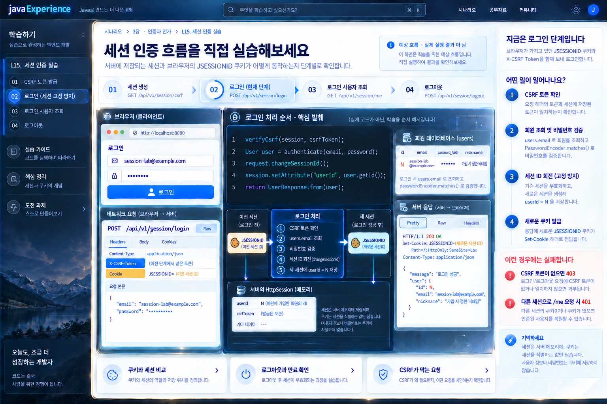

# L15. 세션 인증 — 쿠키 한 장으로 로그인 상태를 이어 보기

<figure class="learning-mockup-figure"><a href="../../../docs/design/mockups-2026-10-15-batch5/08-session-selected.jpg" target="_blank" rel="noopener"><span class="learning-mockup-zoom">원본 크기로 보기 ↗</span></a><figcaption>10-4 JWT를 먼저 마친 뒤 세션 방식과 비교합니다. 이미지의 작은 코드는 처리 순서 설명이며, 구현 계약은 아래 본문을 따릅니다.</figcaption></figure>

> 선택 실습 · 10-4 JWT 로그인을 끝낸 **별도 project DB 작업 브랜치**에서 진행 · Spring MVC + Servlet `HttpSession`

## 상황

같은 사용자가 두 번 요청한다. 첫 요청은 이메일과 비밀번호를 보낸다. 두 번째 요청에는 비밀번호가 없다. 서버는 어떻게 같은 사람인지 알아볼까? [F2의 방문 횟수 실습](../../../lessons/F2-auth-token.md)은 세션이 값을 기억하는 것을 보여 줬다. 여기서는 그 값을 **로그인한 회원 id**로 바꾸고, 로그인·내 정보·로그아웃·만료까지 직접 구현한다.

`10-4`의 JWT 구현을 먼저 끝내고, 같은 project DB와 회원을 쓰는 별도 경로에서 비교한다. 기존 JWT 인터셉터는 `/api/v1/session/**`를 제외해 세션 요청을 Bearer 토큰 없이 처리하게 한다. 이 실습의 브라우저는 `Authorization` 대신 `JSESSIONID` 쿠키를 자동으로 보내며, 서버는 자기 세션 저장소에서 회원 id를 찾는다. 로그인 과정에서만 `users`를 이메일로 찾고 BCrypt 해시와 비밀번호를 비교한다. `/me`는 세션의 id를 근거로 현재 회원을 DB에서 다시 읽는다. **세션 id 자체를 회원 id나 비밀번호로 쓰지 않는다.**

## 먼저 만들 결과

한 데이터로 이어서 본다. `POST /api/v1/users`로 이메일 `session-lab@example.com`을 가입시키고 **실제 응답 id**를 기록한다. 먼저 완성한 10-4의 `POST /api/v1/auth/login`으로 **이 회원의 JWT도 발급**받아 둔다. 아래에서 `N`은 가입 응답의 id이며 고정값이 아니다.

| 순서 | 요청 | 기대하는 관찰 |
|---|---|---|
| 준비 | 같은 회원의 `POST /api/v1/auth/login` | 200 `{accessToken, expiresIn: 3600}`. 뒤의 세션 로그아웃과 비교할 JWT를 기록 |
| 1 | `GET /api/v1/session/csrf` | 익명 세션의 `JSESSIONID` 쿠키와 무작위 `csrfToken`. 아직 로그인한 회원 없음 |
| 2 | 같은 쿠키와 CSRF 헤더로 `POST /api/v1/session/login` | 200, 회원 id `N`, 로그인 전과 **다른 세션 id**. 응답에 비밀번호·해시 없음 |
| 3 | 새 쿠키로 `GET /api/v1/session/me` | 200, DB의 `N`과 이메일·닉네임. 비밀번호를 다시 보내지 않음 |
| 4 | 다른 쿠키 jar 또는 쿠키 없이 `/me` | 401. 기존 jar의 로그인은 유지 |
| 5 | 새 쿠키와 CSRF 헤더로 `POST /api/v1/session/logout` | 204. 같은 쿠키로 `/me`는 401 |
| 6 | 다시 로그인한 뒤 짧은 실습 만료 시간이 지남 | `/me` 401. 기간은 테스트용 설정에 따르며 특정 초를 실측값처럼 쓰지 않음 |

세션 로그아웃 뒤에도 앞 단계에서 발급한 JWT가 만료 전에는 계속 유효할 수 있음을 **예측한 뒤** 같은 회원의 JWT로 `/api/v1/users/me`를 요청해 확인한다.

## 직접 구현할 계약

이 실습만의 `/api/v1/session/**` 경로를 사용한다. 기존 가입·JWT 경로는 교체하지 않는다. 10-3에서 만든 `UserRepository`, `PasswordEncoder`, 공통 응답·오류 틀을 재사용한다. `UserService.me`의 DB 조회와 반환 DTO는 재사용할 수 있다. 실습용 프로필에서 단일 서버·메모리 세션으로 시작한다.

1. `GET /csrf`: `request.getSession(true)`로 익명 세션을 만들고, 예측하기 어려운 CSRF 토큰을 한 번 생성해 세션에 저장한 뒤 응답한다. 쿠키에는 세션 id만 둔다. 토큰·세션 id를 서버 로그에 남기지 않는다.
2. `POST /login`: 같은 쿠키의 세션과 `X-CSRF-Token`을 확인한다. 토큰이 없거나 다르면 **403**이며 비밀번호 검사는 시작하지 않는다. 성공하면 이메일을 `strip().toLowerCase(Locale.ROOT)`로 정규화해 `users.email`로 찾고 `PasswordEncoder.matches`로 검증한다. 없는 이메일과 틀린 비밀번호는 같은 **401** 문구다. 비밀번호 규칙은 가입 때의 길이 규칙을 다시 적용하지 않고 공백 여부만 본다. 성공한 기존 익명 세션에 `request.changeSessionId()`를 적용해 **세션 id를 회전**하고, 세션 속성에 `userId=N`을 저장한다. CSRF 토큰은 같은 세션의 속성으로 이어진다.
3. `GET /me`: `getSession(false)`로 이미 존재하는 세션만 찾는다. `userId`가 없으면 401이고 **새 세션을 만들지 않는다**. 있으면 `users.id`로 회원을 다시 조회해 `{id,email,nickname}`을 반환한다. 조회할 수 없는 회원도 401로 처리한다.
4. `POST /logout`: 로그인 세션과 CSRF 헤더를 확인하고 `session.invalidate()`한다. 응답은 204다. 클라이언트의 오래된 쿠키로 다시 와도 회원으로 인정하지 않는다. 토큰이 틀리면 403이며 세션은 유지한다.
5. 유휴 만료: 실습용 timeout 설정을 짧게 하고, 마지막 접근 뒤 만료되면 세션의 `userId`를 복구하지 못함을 확인한다. **요청이 오지 않은 시간**을 기준으로 한다. 시스템 시간을 코드에서 직접 더해 비교하는 별도 만료 로직을 만들지 않는다.

세션 쿠키는 `HttpOnly`, `SameSite=Lax`를 확인한다. 로컬 HTTP의 `Secure`와 배포 HTTPS의 `Secure` 차이를 기록한다. CSRF 보호는 브라우저가 쿠키를 자동으로 보내는 데서 나온다. `Origin` 또는 CORS 설정만으로 이 토큰 검사를 대체하지 않는다. 세션·CSRF 문자열은 URL 쿼리, 로그, 화면 저장소에 넣지 않는다. 10-4의 401 `WWW-Authenticate: Bearer` 처리가 세션 경로에 잘못 붙는다면 인증 방식에 따라 전역 오류 처리를 나눈다.

Spring Security를 사용하는 운영 앱의 인증 필터·세션 저장/복원·로그아웃은 [S12 보안 구조](../../../docs/knowledge/S12-security-architecture.md)에 따로 있다. 이 실습은 Servlet 세션의 경계를 직접 관찰하기 위한 작은 구현이다. 분산 서버·Redis 세션은 여기의 합격 조건이 아니다.

## 요청으로 검증하기

실습 서버 주소는 예시다. 쿠키 jar 파일은 작업 폴더의 임시 파일로 두고 버전 관리에 넣지 않는다. 아래 명령의 `TOKEN`과 `N`은 실제 응답 값으로 대체한다.

```bash
# 이미 10-3으로 회원을 만든 뒤
curl -i -c session-before.jar http://localhost:8080/api/v1/session/csrf
curl -i -b session-before.jar -c session-after.jar \
  -H 'Content-Type: application/json' -H 'X-CSRF-Token: TOKEN' \
  -d '{"email":"session-lab@example.com","password":"password1234"}' \
  http://localhost:8080/api/v1/session/login
curl -i -b session-after.jar http://localhost:8080/api/v1/session/me
curl -i http://localhost:8080/api/v1/session/me
curl -i -X POST -b session-after.jar -H 'X-CSRF-Token: TOKEN' \
  http://localhost:8080/api/v1/session/logout
curl -i -b session-after.jar http://localhost:8080/api/v1/session/me
```

요청마다 Set-Cookie가 반드시 다시 온다고 가정하지 않는다. `-b`·`-c` jar의 실제 `JSESSIONID` 값을 **로컬에서만** 비교한다. 로그인 전 id와 후 id는 달라야 하고, 로그인 후 `/me`의 응답 회원 id는 가입 응답 id와 같아야 한다.

실패도 만든다. CSRF 헤더 없는 로그인·로그아웃은 403이고 세션의 인증 상태가 바뀌지 않아야 한다. 틀린 비밀번호는 401이지만 회원 존재 여부를 메시지로 구별할 수 없어야 한다. 다른 jar로 `/me`를 보내면 401이다. 로그아웃 뒤의 옛 쿠키도 401이다. 서버를 재시작하고 메모리 세션이 사라지는 것을 관찰할 수 있지만, 테스트를 위해 기존 DB를 초기화하지 않는다.

## 합격 기준

- [ ] 회원 가입에서 얻은 실제 id `N`이 로그인·`/me`의 DB 조회·응답까지 이어지고 비밀번호 원문이나 해시가 응답에 없다.
- [ ] 익명 CSRF 세션의 id가 로그인 때 회전하며, 이전 id만 재사용하면 인증되지 않는다.
- [ ] 같은 쿠키는 로그인 상태를 복원하고 다른 쿠키·무쿠키는 401이다. `/me`가 익명 호출에 새 세션을 만들지 않는다.
- [ ] 로그인·로그아웃의 CSRF 누락·불일치가 403이고 상태를 바꾸지 않는다. 성공 로그아웃·유휴 만료 뒤에는 401이다.
- [ ] 기존 10-3 가입 테스트와 10-4 JWT 테스트가 그대로 통과한다. 이 실습의 쿠키 인증과 Bearer 인증을 혼동하지 않는다.
- [ ] 어떤 메서드가 세션을 만들고, 회원 id를 저장하고, 쿠키를 받아 복원하고, DB를 조회하고, 세션을 없애는지 코드 위치로 설명한다.

코드 답안을 바로 복사해 넣는 것보다, 먼저 실패 결과를 예측하고 본인이 구현한 HTTP·쿠키·DB 증거로 설명한다. 다음은 [10-4 JWT 로그인](../../ch10-project/10-4-login-jwt.md)과 비교한다.
