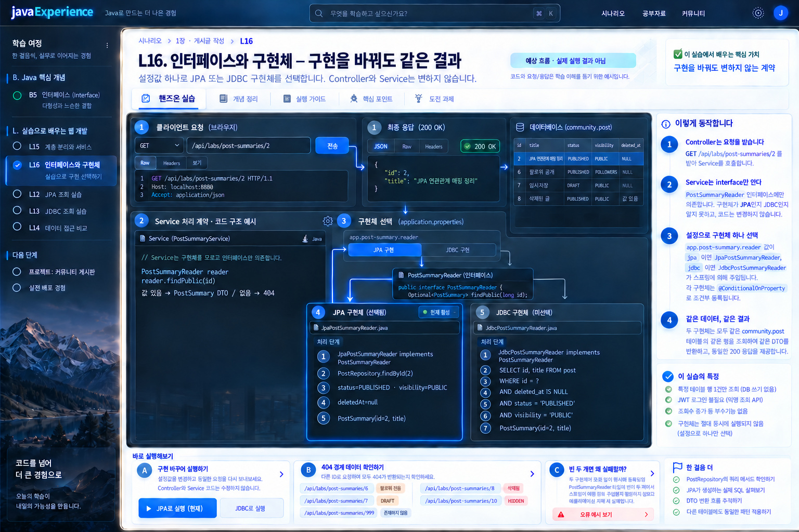

# L16. interface와 impl — 같은 API를 JPA·JDBC 두 구현으로 읽기

<figure class="learning-mockup-figure"><a href="../../../docs/design/mockups-2026-10-15-batch5/07-interface-selected.jpg" target="_blank" rel="noopener"><span class="learning-mockup-zoom">원본 크기로 보기 ↗</span></a><figcaption>두 구현체는 설정에 따라 하나씩 실행합니다. 화면의 코드 형태는 개념 시안이며, 실제 조건·SQL·합격 기준은 아래에서 확인합니다.</figcaption></figure>

> 선택 실습 · 본편 2-3 뒤 `community` DB · Java interface/impl → Spring 빈 선택 → SQL/JPA 계약 검증

## 상황

[B5 인터페이스 실습](../../../lessons/B5-interfaces.md)에서는 `new MemoryPostRepository()`를 다른 구현체로 바꿨다. 실제 Spring Boot 앱에서는 Service가 객체를 직접 `new`하지 않는다. **인터페이스를 받는 생성자**는 그대로 두고, Spring이 주입할 구현체를 설정으로 고른다. 두 구현체가 같은 DB의 같은 글을 읽으면 API 응답도 같아야 한다.

공개 글 `id=2`를 한 번씩 `jpa`, `jdbc` 구현으로 조회한다. 또 팔로워 공개 `id=6`, 임시저장 `id=7`, 삭제 `id=8`, 운영자 숨김 `id=10`과 없는 id를 요청한다. 이 실습은 두 저장 기술의 공통 계약을 확인한다. 기존 2-3의 전체 회원별 접근 정책은 수정하지 않고, **익명에게도 보이는 공개 글만** 이 실습 API에서 반환한다.

## 요청과 데이터 한 건

`GET /api/labs/post-summaries/2`의 성공 응답은 `{ "id": 2, "title": "JPA 연관관계 매핑 정리" }`다. 먼저 [community seed](../../../docker/mysql/init/01-community.sql)의 `post` 행을 직접 조회한다. 그 행에는 `status=PUBLISHED`, `visibility=PUBLIC`, `deleted_at=NULL`이 있다. JPA도 JDBC도 이 세 조건을 지켜야 한다. `id=6/7/8/10` 또는 없는 id는 모두 404다. 이 실습 API는 조회수를 올리거나 DB 행을 바꾸지 않는다.

## 직접 만들 것

1. **계약:** `PostSummaryReader` 인터페이스에 `Optional<PostSummary> findPublic(long id)` 한 메서드를 만든다. `PostSummary`는 `id`, `title` 두 값만 담는 불변 DTO다. `PostSummaryService`는 이 인터페이스만 생성자로 받고, 결과가 없으면 404로 바꾼다. Controller는 `GET /api/labs/post-summaries/{id}`만 연결한다. `id<=0`은 400으로 처리한다.
2. **JPA 구현:** `JpaPostSummaryReader implements PostSummaryReader`. 기존 `PostRepository` 또는 JPA 쿼리에서 id와 `deletedAt=null`, `status=PUBLISHED`, `visibility=PUBLIC`을 확인한다. `Post` Entity를 HTTP로 직접 내보내지 않는다. 이미 DB에 읽은 Entity 값에서 DTO로 변환한다.
3. **JDBC 구현:** `JdbcPostSummaryReader implements PostSummaryReader`. 필요하면 프로젝트에 `spring-boot-starter-jdbc`를 추가한다. `JdbcTemplate`의 바인딩 파라미터로 아래 SQL을 실행하고 DTO로 매핑한다. ID를 SQL 문자열에 이어 붙이지 않는다.

   ```sql
   SELECT id, title
   FROM post
   WHERE id = ?
     AND deleted_at IS NULL
     AND status = 'PUBLISHED'
     AND visibility = 'PUBLIC'
   ```

4. **Spring 빈 선택:** `app.post-summary.reader=jpa`를 기본값, `jdbc`를 다른 값으로 둔다. 각 구현체를 조건부로 등록해 **한 번에 하나만** `PostSummaryReader` 빈이 생기게 한다. 예를 들면 `@ConditionalOnProperty(name="app.post-summary.reader", havingValue="jpa", matchIfMissing=true)`와 `havingValue="jdbc"`를 쓸 수 있다. Service와 Controller 코드는 설정을 바꿀 때 수정하지 않는다.
5. **실패를 보고 복구:** 잠시 두 조건을 모두 없애 두 구현을 동시에 빈으로 등록한다. 주입 후보가 둘이라 애플리케이션 시작이 실패하는 것을 관찰한다. 예외에 나오는 두 구현체 이름을 찾은 뒤 조건을 다시 넣는다. 빈을 하나도 등록하지 않은 경우도 서비스 생성에 실패한다는 것을 설명한다. 실패 실험은 서버를 구동해 확인한 뒤 원래 설정으로 복구한다.

## 같은 계약을 두 번 확인하기

설정값마다 앱을 실행하고 동일한 테스트를 돌린다. 서버를 하나씩 실행한다. `community` DB와 seed는 바꾸지 않는다.

```bash
./gradlew bootRun --args='--app.post-summary.reader=jpa'
curl -i http://localhost:8080/api/labs/post-summaries/2
```

JPA 서버를 종료한 뒤:

```bash
./gradlew bootRun --args='--app.post-summary.reader=jdbc'
curl -i http://localhost:8080/api/labs/post-summaries/2
```

HTTP 200의 JSON 필드·값이 같고, `6/7/8/10/없는 id`는 각각 404인지 표로 비교한다. 추가로 DB에서 `SELECT id,title,status,visibility,deleted_at FROM post WHERE id IN (2,6,7,8,10)`을 실행해 결과 이유를 설명한다. `JdbcTemplate`이 어떤 SQL을 실행했는지와 JPA가 실제로 몇 쿼리를 냈는지는 **본인 로그·실행 결과로** 확인한다. 이 문서의 예상 쿼리 수를 실측처럼 적지 않는다.

최소 한 번은 같은 계약 테스트를 두 설정에서 모두 실행한다. 이 테스트는 Controller/Service/Reader를 실제로 연결하고 DB가 있는 환경에서 200·404를 검증한다. `PostSummaryService`의 단위 테스트는 두 구현체 대신 `PostSummaryReader`를 가짜로 넣어 200·404 변환을 따로 확인한다. 두 테스트의 목적을 구분한다.

## 합격 기준

- [ ] Service 생성자가 인터페이스 타입 하나를 받고, 구현체 이름을 분기하거나 직접 `new`하지 않는다.
- [ ] JPA·JDBC 두 구현이 같은 `post.id=2`에 같은 `{id,title}`을 반환한다. 공개 조건 밖의 네 seed와 없는 id는 두 구현 모두 404다.
- [ ] `@ConditionalOnProperty` 설정 전후 실제 빈 후보 수를 설명할 수 있다. 두 후보 실험을 재현하고 정상 한 후보 설정으로 복구했다.
- [ ] JDBC SQL의 `?` 바인딩과 JPA의 조건을 비교하고, HTTP 응답에 Entity 전체나 비공개 필드가 새지 않는다.
- [ ] 같은 통합 계약 테스트가 `jpa`·`jdbc` 설정에서 모두 통과하고, `community`의 원래 행은 바뀌지 않는다.
- [ ] 요구사항을 "공개 글 제목에 게시판 slug를 추가"로 바꾸면 인터페이스·DTO·두 구현·계약 테스트 중 무엇을 함께 바꿔야 하는지 먼저 적고 실제로 적용해 본다. `board_id`와 `board.slug` 관계를 사용하고 빈 선택 코드는 유지한다.

이 실습은 이전 [2-3 접근 정책](../../ch2-read-post/2-3-visibility.md)을 대체하지 않는다. 다음에는 [L12~L14 쿼리 연습](../l12-query-methods/README.md)에서 파생 쿼리·`@Query`·동적 SQL로 확장한다.
